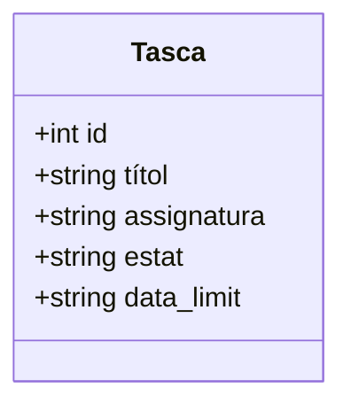

# SPECIFICATIONS.md — Sistema Tasks_app (v2.0)

## Historial de versions
- v1.0 (Increment 1): persistència JSON, creació i llistat de tasques (US-01–02, RF-01–04, GS-01–03).
- v2.0 (Increment 2): data límit, edició, compleció i avisos temporals (US-03–06, RF-05–13, GS-04–15). Es mantenen les funcionalitats de v1.0.

## 1. Visió General
Tasks_app és una eina CLI lleugera per ajudar als estudiants a gestionar les seves tasques acadèmiques diàries.

## 2. User Stories (Històries d'Usuari)
- US-01: Com a estudiant, vull afegir una tasca amb títol i assignatura per recordar els meus deures.
- US-02: Com a estudiant, vull veure la llista de tasques pendents per organitzar el meu temps.

### Increment 2 — Noves històries d'usuari
- US-03: Com a estudiant, vull indicar la data límit d'una tasca per planificar-ne el lliurament.
- US-04: Com a estudiant, vull modificar les dades d'una tasca per corregir errors de registre.
- US-05: Com a estudiant, vull marcar una tasca com a completada per fer un seguiment del meu progrés.
- US-06: Com a estudiant, vull identificar les tasques pendents urgents i caducades per prioritzar la feina.

## 3. Model de Dades (Mermaid)

## 4. Requisits
- RF-01 : El sistema tasks_app ha de guardar les tasques en un fitxer JSON de persistència local.
- RF-02 : Si el fitxer `data/tasks.json` no existeix, el sistema tasks_app ha de crear `data/tasks.json` inicialitzat amb una llista JSON buida ([]).
- RF-03 : El sistema tasks_app ha de proveir a l'estudiant la capacitat de crear una nova tasca amb estat 'pendent' mitjançant el comandament add --title <títol> --subject <assignatura>.
- RF-04: El sistema tasks_app ha de proveir a l’estudiant la capacitat de visualitzar totes les tasques registrades (incloent-hi el seu ID, títol, assignatura i estat) mitjançant el comandament list.
- RF-05: El sistema tasks_app ha de proveir a l'estudiant la capacitat de canviar l'estat d'una tasca pendent a completada mitjançant el comandament complete --id <id> .
- RF-06: El sistema tasks_app ha de proveir a l'estudiant la capacitat de canviar l'estat d'una tasca modificada pendent mitjançant el comandament undo --id <id>.
- RF-07: El sistema tasks_app ha de proveir a l'estudiant la capacitat d'eliminar una tasca existent mitjançant el comandament delete --id <id> .

### Increment 2 — Nous requisits (SOPHIST)

- RF-08 (US-03): El sistema Tasks_app ha de proveir a l'estudiant la capacitat d'indicar una data límit opcional en crear una tasca mitjançant l'opció `--due YYYY-MM-DD` del comandament `add`.

- RF-09 (US-03, US-04): Si l'estudiant indica una data límit amb un format diferent de `YYYY-MM-DD` o que no correspon a una data vàlida del calendari, el sistema Tasks_app ha de rebutjar l'operació, informar de l'error i finalitzar amb un codi de sortida diferent de zero sense modificar el registre.

- RF-10 (US-04): El sistema Tasks_app ha de proveir a l'estudiant la capacitat de modificar una tasca existent mitjançant `edit --id <ID>` i una o més de les opcions `--title <títol>`, `--subject <assignatura>`, `--due YYYY-MM-DD` i `--status pendent|completada`, mantenint l'identificador i els atributs no indicats.

- RF-11 (US-05): El sistema Tasks_app ha de proveir a l'estudiant la capacitat de marcar una tasca existent com a completada mitjançant `complete --id <ID>`, conservant-ne els altres atributs. Si ja està completada, ha de conservar aquest estat.

- RF-12 (US-04, US-05): Si l'identificador indicat a `edit` o `complete` no correspon a cap tasca registrada, el sistema Tasks_app ha d'informar de l'error i finalitzar amb un codi de sortida diferent de zero sense modificar el registre.

- RF-13 (US-04): Si l'estudiant executa `edit` sense cap atribut a modificar o indica un estat diferent de `pendent` o `completada`, el sistema Tasks_app ha de rebutjar l'operació, informar de l'error i finalitzar amb un codi de sortida diferent de zero sense modificar el registre.

- RF-14 (US-06): Si una tasca pendent té una data límit anterior a la data local actual, el sistema Tasks_app ha de mostrar l'etiqueta `[CADUCADA]` en llistar-la.

- RF-15 (US-06): Si una tasca pendent té una data límit igual a la data local actual o situada entre un i sis dies naturals després, el sistema Tasks_app ha de mostrar l'etiqueta `[URGENT]` en llistar-la.

- RF-16 (US-03, US-04, US-05, US-06): El sistema Tasks_app ha de conservar la persistència JSON dels atributs de cada tasca després de cada operació correcta, i ha de permetre consultar les tasques de la versió anterior sense data límit.

### Regles de domini i de presentació de l'Increment 2

- L'identificador és únic, estable i no editable; identifica la tasca sobre la qual s'opera. La data límit és opcional per mantenir la compatibilitat amb v1.0. Una data passada és vàlida.
- El format JSON conserva les claus `id`, `title`, `subject` i `status` de v1.0. Si hi ha data límit, es desa com a cadena `due` en format `YYYY-MM-DD`; si no n'hi ha, s'omet aquesta clau per conservar el format de v1.0. Es manté la lectura de les claus alternatives ja admeses a v1.0.
- En crear una tasca, l'estat inicial continua sent `pendent`. Els estats vàlids per a l'edició són `pendent` i `completada`.
- El llistat conserva el format de v1.0 i, si hi ha data límit, hi afegeix ` - data límit: YYYY-MM-DD`. Si correspon una etiqueta temporal, l'afegeix al final, separada per un espai. No mostra cap etiqueta si la tasca està completada, no té data límit o en falten set dies naturals o més. Les etiquetes són excloents i no es desen al JSON.
- Les operacions `edit` i `complete` correctes finalitzen amb codi 0 i confirmen respectivament `Tasca [ID: <ID>] modificada amb èxit` i `Tasca [ID: <ID>] completada amb èxit`. Els errors indiquen el motiu a stderr. Una operació incorrecta no modifica el contingut del registre.

## 5. Criteris d’acceptació i proves (Gherkin scenarios)

### Increment 1 — Escenaris de regressió

- GS-01: Creació correcta d'una tasca
  Atès que la base de dades JSON no conté encara tasques
  quan l’estudiant executa `python src/tasks_app.py add --title 'Pràctica 1' --subject 'RS'`
  aleshores el sistema confirma `Tasca [ID: 1] creada amb èxit`
  i la tasca queda registrada al fitxer `data/tasks.json`.

- GS-02: Llistat de tasques quan `data/tasks.json` no conté registres
  Atès que la base de dades JSON no conté encara tasques
  quan l’estudiant executa `python src/tasks_app.py list`
  aleshores el sistema mostra `Registre de tasques buit.`

- GS-03: Llistat de tasques quan data/tasks.json conté registres
  Atès que el fitxer `data/tasks.json` conté les següents tasques:

  | id | títol          | assignatura | estat   |
  | 1  | Pràctica 1     | RS          | pendent |
  | 2  | Examen parcial | SO          | pendent |

  quan l’estudiant executa `python src/tasks_app.py list`
  aleshores el sistema mostra per pantalla:
    "[1] Pràctica 1 (RS) - estat: pendent"
    "[2] Examen parcial (SO) - estat: pendent"

- GS-04: Modificar l'estat d'una tasca existent a completat quan té les següents tasques:
| id | títol          | assignatura | estat   |
    | 1  | Pràctica 1     | RS          | pendent |
    | 2  | Examen parcial | SO          | pendent |
  hauria de canviar-les a:
  | id | títol          | assignatura | estat   |
    | 1  | Pràctica 1     | RS          | completada |
    | 2  | Examen parcial | SO          | pendent |
  el sistema mostra un missatge de confirmació.

- GS-05: Modificar l'estat d'una tasca completada a pendent quan té les següents tasques:
| id | títol          | assignatura | estat   |
    | 1  | Pràctica 1     | RS          | pendent |
    | 2  | Examen parcial | SO          | pendent |
  hauria de canviar-les a:
  | id | títol          | assignatura | estat   |
    | 1  | Pràctica 1     | RS          | completada |
    | 2  | Examen parcial | SO          | pendent |
    el sistema mostra un missatge de confirmació.

- GS-06: Intentar marcar com a completada una tasca que ja està en aquest estat, aleshores
el sistema imprimeix un missatge de `Tasca [ID: (el id correcpondiente)] ja està marcada com a completada`

- GS-07: Intentar marcar com a pendent una tasca que ja està en aquest estat, aleshores
el sistema imprimeix un missatge de `Tasca [ID: (el id correcpondiente)] ja està marcada com a pendent`

- GS-08: Intentar canviar d'estat una tasca no existent, aleshores el sistema imprimeix un missatge
`Tasca [ID: (el id correcpondiente)] no existeix`

- GS-09: Eliminar una tasca existent, quan el fitxer `data/tasks.json` conté les següents tasques:
| id | títol          | assignatura | estat   |
    | 1  | Pràctica 1     | RS          | pendent |
    | 2  | Examen parcial | SO          | pendent |
    ha de quedar: 
    | id | títol          | assignatura | estat   |
    | 2  | Examen parcial | SO          | pendent |
    i ha de mostrar un missatge de confirmació
  
- GS-10: Eliminar una tasca no existent, aleshores el sistema imprimeix el missatge `Tasca [ID: (el id correcpondiente)] no existeix`

### Increment 2 — Nous escenaris Gherkin

Les dates relatives a la data actual s'han de calcular de manera reproduïble en les proves (data controlada o dates relatives al dia d'execució).

#### GS-11 — Alta amb data límit (RF-08, RF-16)
Atès que el registre és buit
Quan l'estudiant executa `python3 src/tasks_app.py add --title 'Pràctica 2' --subject RS --due 2026-12-02`
Aleshores el sistema confirma `Tasca [ID: 1] creada amb èxit`
I el registre JSON conté la tasca amb ID 1, títol `Pràctica 2`, assignatura `RS`, estat `pendent` i `due` igual a `2026-12-02`.

#### GS-12 — Data límit incorrecta (RF-09)
Atès que existeix un registre amb dades
Quan l'estudiant executa `add --title Prova --subject RS --due <data>`
Aleshores el sistema informa que la data és incorrecta
I finalitza amb un codi diferent de zero
I el contingut del registre no canvia.

Exemples de `<data>`: `2026-2-03`, `2026-02-30`, `02/12/2026`.

#### GS-13 — Edició parcial (RF-10, RF-16)
Atès que la tasca 1 té títol `Pràctica 1`, assignatura `RS`, estat `pendent` i data límit `2026-12-02`
Quan l'estudiant executa `edit --id 1 --title 'Pràctica revisada'`
Aleshores el sistema confirma `Tasca [ID: 1] modificada amb èxit`
I el JSON conté el títol nou mantenint ID, assignatura, estat i data límit.

#### GS-14 — Edició de diversos atributs (RF-10, RF-16)
Atès que existeix la tasca 1 amb estat `pendent`
Quan l'estudiant executa `edit --id 1 --title 'Examen final' --subject SO --due 2026-12-15 --status completada`
Aleshores el registre conserva l'ID 1 i desa els quatre atributs indicats
I una lectura posterior del registre recupera aquests atributs.

#### GS-15 — Compleció d'una tasca (RF-11, RF-16)
Atès que existeix la tasca 1 amb estat `pendent`
Quan l'estudiant executa `complete --id 1`
Aleshores el sistema confirma `Tasca [ID: 1] completada amb èxit`
I el JSON desa l'estat `completada` mantenint els altres atributs
I una segona execució del mateix comandament conserva l'estat `completada`.

#### GS-16 — ID inexistent (RF-12)
Atès que el registre conté una tasca amb ID 1 i no conté l'ID 99
Quan l'estudiant executa `<comandament>`
Aleshores el sistema informa que la tasca no existeix, finalitza amb codi diferent de zero i el registre no canvia.

Exemples de `<comandament>`: `edit --id 99 --title Prova`, `complete --id 99`.

#### GS-17 — Llistat de tasques caducades i urgents (RF-14, RF-15, RF-16)
Atès que la data local actual és el 24/11/2026 (o una data equivalent controlada a la prova)
I hi ha tasques pendents amb les dates límit següents:

| ID | Data límit | Etiqueta esperada |
|---|---|---|
| 1 | 2026-11-23 | [CADUCADA] |
| 2 | 2026-11-24 | [URGENT] |
| 3 | 2026-11-25 | [URGENT] |
| 4 | 2026-11-30 | [URGENT] |
| 5 | 2026-12-01 | Cap |
| 6 | 2026-12-02 | Cap |

Quan l'estudiant executa `list`
Aleshores cada tasca es mostra amb les seves dades, la data límit i només l'etiqueta esperada si correspon
I el registre no es modifica.

#### GS-18 — Tasques sense etiqueta temporal (RF-14, RF-17, RF-16)
Atès que existeix una tasca completada amb data límit passada, una completada amb data límit pròxima i una pendent sense data límit
Quan l'estudiant executa `list`
Aleshores el sistema mostra les tres tasques sense les etiquetes `[CADUCADA]` ni `[URGENT]`
I la tasca sense data conserva el format de llistat de v1.0.

#### GS-19 — Edició amb data incorrecta (RF-09, RF-10)
Atès que existeix la tasca 1 amb títol `Original` i data límit vàlida
Quan l'estudiant executa `edit --id 1 --title Nou --due 2026-02-30`
Aleshores el sistema informa de l'error i finalitza amb codi diferent de zero
I el registre conserva tant el títol original com la data original.

#### GS-20 — Edició sense atributs o amb estat invàlid (RF-13)
Atès que existeix la tasca 1
Quan l'estudiant executa `<comandament>`
Aleshores el sistema informa de l'error, finalitza amb codi diferent de zero i el registre no canvia.

Exemples de `<comandament>`: `edit --id 1`, `edit --id 1 --status desconegut`.

#### GS-21 — Compatibilitat amb el registre de v1.0 (RF-08, RF-16)
Atès que el JSON conté una tasca de v1.0 sense clau `due`
Quan l'estudiant afegeix una segona tasca sense indicar data límit i després executa `list`
Aleshores ambdues tasques es mostren amb el format de v1.0 i sense etiquetes temporals
I la primera tasca conserva totes les dades originals
I la segona es desa amb un identificador diferent i estat `pendent`.

#### GS-22 — Format de llistat amb data límit (RF-07, RF-14, RF-15, RF-16)
Atès que la data local actual és el 24/11/2026 (o una data equivalent controlada a la prova)
I existeix la tasca pendent 1 amb títol `Pràctica 2`, assignatura `RS` i data límit `2026-11-25`
Quan l'estudiant executa `list`
Aleshores el sistema mostra `[1] Pràctica 2 (RS) - estat: pendent - data límit: 2026-11-25 [URGENT]` (amb la data equivalent si escau).
