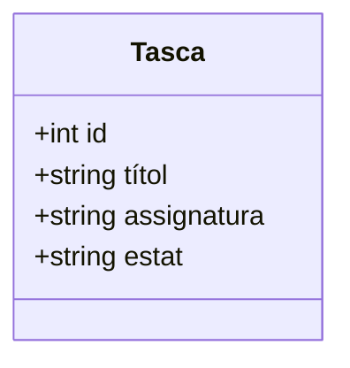

# SPECIFICATIONS.md — Sistema Tasks_app (v1.0)

## 1. Visió General
Tasks_app és una eina CLI lleugera per ajudar als estudiants a gestionar les seves tasques acadèmiques diàries.

## 2. User Stories (Històries d'Usuari)
- US-01: Com a estudiant, vull afegir una tasca amb títol i assignatura per recordar els meus deures.
- US-02: Com a estudiant, vull veure la llista de tasques pendents per organitzar el meu temps.
- US-03: Com a estudiant, vull poder marcar una tasca com a completada per indicar quan ha finalitzat.
- US-04: Com a estudiant, vull poder marcar una tasca completada com a pendent per indicar que encara falta alguna cosa a fer.
- US-05: Com a estudiant, vull poder eliminar una tasca mitjançant l'id per no haver de mantenir registre de tasques que ja no són importants.

## 3. Model de Dades (Mermaid)

## 4. Requisits
- RF-01 : El sistema tasks_app ha de guardar les tasques en un fitxer JSON de persistència local.
- RF-02 : Si el fitxer `data/tasks.json` no existeix, el sistema tasks_app ha de crear `data/tasks.json`  inicialitzat amb una llista JSON buida ([])
- RF-03 : El sistema tasks_app ha de proveir a l'estudiant la capacitat de crear una nova tasca amb estat 'pendent' mitjançant el comandament add --title <títol> --subject <assignatura>.
- RF-04: El sistema tasks_app ha de proveir a l’estudiant la capacitat de visualitzar totes les tasques registrades (incloent-hi el seu ID, títol, assignatura i estat) mitjançant el comandament list.
- RF-05: El sistema tasks_app ha de proveir a l'estudiant la capacitat de canviar l'estat d'una tasca pendent a completada mitjançant el comandament complete --id <id> .
- RF-06: El sistema tasks_app ha de proveir a l'estudiant la capacitat de canviar l'estat d'una tasca modificada pendent mitjançant el comandament undo --id <id>.
- RF-07: El sistema tasks_app ha de proveir a l'estudiant la capacitat d'eliminar una tasca existent mitjançant el comandament delete --id <id> .

## 5. Criteris d’acceptació i proves (Gherkin scenarios)
- GS-01: Creació correcta d'una tasca
  Atès que la base de dades JSON no conté encara tasques
  quan l’estudiant executa `python src/tasks_app.py add --title 'Pràctica 1' --subject 'RS'
  aleshores el sistema confirma `Tasca [ID: 1] creada amb èxit`
  i la tasca queda registrada al fitxer `data/tasks.json`.

- GS-02: Llistat de tasques quan `data/tasks.json` no conté registres 
  Atès que la base de dades JSON no conté encara tasques
  quan l’estudiant executa `python src/tasks_app.py list`
  aleshores el sistema mostra `Registre de tasques buit.` 

- GS-03: Llistat de tasques quan data/tasks.json conté registres
  Atès que el fitxer `data/tasks.json` conté les següents tasques:
    | id | títol          | assignatura | estat   |
    | 1  | Pràctica 1     | RS          | pendent |
    | 2  | Examen parcial | SO          | pendent |
  quan l’estudiant executa `python src/tasks_app.py list`
  aleshores el sistema mostra per pantalla:
    "[1] Pràctica 1 (RS) - estat: pendent"
    "[2] Examen parcial (SO) - estat: pendent"

- GS-04: Modificar l'estat d'una tasca existent a completat quan té les següents tasques:
| id | títol          | assignatura | estat   |
    | 1  | Pràctica 1     | RS          | pendent |
    | 2  | Examen parcial | SO          | pendent |
  hauria de canviar-les a:
  | id | títol          | assignatura | estat   |
    | 1  | Pràctica 1     | RS          | completada |
    | 2  | Examen parcial | SO          | pendent |
  el sistema mostra un missatge de confirmació.

- GS-05: Modificar l'estat d'una tasca completada a pendent quan té les següents tasques:
| id | títol          | assignatura | estat   |
    | 1  | Pràctica 1     | RS          | pendent |
    | 2  | Examen parcial | SO          | pendent |
  hauria de canviar-les a:
  | id | títol          | assignatura | estat   |
    | 1  | Pràctica 1     | RS          | completada |
    | 2  | Examen parcial | SO          | pendent |
    el sistema mostra un missatge de confirmació.

- GS-06: Intentar marcar com a completada una tasca que ja està en aquest estat, aleshores
el sistema imprimeix un missatge de `Tasca [ID: (el id correcpondiente)] ja està marcada com a completada`

- GS-07: Intentar marcar com a pendent una tasca que ja està en aquest estat, aleshores
el sistema imprimeix un missatge de `Tasca [ID: (el id correcpondiente)] ja està marcada com a pendent`

- GS-08: Intentar canviar d'estat una tasca no existent, aleshores el sistema imprimeix un missatge
`Tasca [ID: (el id correcpondiente)] no existeix`

- GS-09: Eliminar una tasca existent, quan el fitxer `data/tasks.json` conté les següents tasques:
| id | títol          | assignatura | estat   |
    | 1  | Pràctica 1     | RS          | pendent |
    | 2  | Examen parcial | SO          | pendent |
    ha de quedar: 
    | id | títol          | assignatura | estat   |
    | 2  | Examen parcial | SO          | pendent |
    i ha de mostrar un missatge de confirmació
  
- GS-10: Eliminar una tasca no existent, aleshores el sistema imprimeix el missatge `Tasca [ID: (el id correcpondiente)] no existeix`

